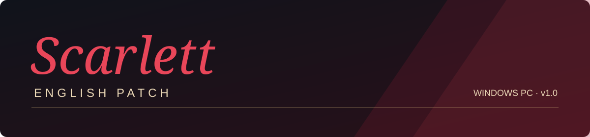

  

# Scarlett English Patch

An English translation patch for the original Windows PC release of **Scarlett** by **nekoneko-software**.

**v1.0 · First public release**

[**Download v1.0**](https://github.com/Dern00/scarlett-english-patch/releases/tag/v1.0) · [Installation](#installation) · [Report an issue](https://github.com/Dern00/scarlett-english-patch/issues/new/choose)

## Features

- English scenario text, Cyclopedia entries, chapter summaries and bonus content.
- Translated menus and interface artwork, with the original visual design preserved.
- ScarlettFont for dialogue, speaker names and backlog, with wrapping and layout adjustments for the game's different text boxes.
- A cleaner chapter menu with aligned, readable labels.
- A persistent **Keep voice** option, alongside voice-playback and backlog-ambience repairs.
- A folder-picker installer with verified backups, integrated save handling and a matching restore tool.

## Requirements

- Your own copy of the original **Japanese Windows PC game**, with **both official updates** installed.
- Windows with Japanese system locale, or a compatible Japanese locale environment.

The patch does not install the game or change Windows locale. Python and an internet connection are not required for installation.

## Installation

1. Close Scarlett. Keep a backup of your game and saves; a separate game copy is recommended.
2. Download **Scarlett_English_Patch_v1.0.zip** from [Releases](https://github.com/Dern00/scarlett-english-patch/releases/tag/v1.0).
3. Extract the **entire ZIP** into a folder outside the game folder.
4. Run **Install.cmd**, then choose the Scarlett game folder.
5. Launch **Scarlett.exe** from the patched game folder and start a new game.

Use the release ZIP rather than GitHub's **Code → Download ZIP** source archive. The source archive does not contain the playable patch payload.

The installer checks the supported game files before replacing them and keeps exact backups under `Scarlett-English-Patch` in the selected folder. Keep that folder for restoration.

## Saves and restoration

Japanese scene saves are unsupported. Japanese shared progress, including Cyclopedia registrations, can be converted when the profile contains no unsupported scene saves. The installer validates the whole profile before applying a conversion and retains the original `savedata` folder in its backup.

To restore, close the game and run **Restore.cmd**, choosing the same game folder. It restores the pre-install files and save profile while retaining any newer saves separately as `savedata-after-patch` in the selected installation backup.

[Save handling and recovery](SAVE-MIGRATION.md) explains the version prompt, backup locations and interrupted-install recovery.

## Keep voice

In **Settings**, use **Keep voice → Change** to switch between **On** and **Off**.

- **On** (default): ordinary clicks let the current voice finish. A new voiced line replaces it; scripted stops and skipping still stop playback.
- **Off**: advancing dialogue stops the current voice.

The setting is remembered across restarts. **Restore Defaults** returns it to On.

## Download verification

The release includes a `.sha256` file for the ZIP. [RELEASES.json](RELEASES.json) also records its size and SHA-256 hash. The extracted package includes checksums for its individual files.

## Feedback

[Open an issue](https://github.com/Dern00/scarlett-english-patch/issues/new/choose) with the patch version, steps to reproduce the problem, and a screenshot where useful. For save-related problems, say whether the profile began in the Japanese game. Please check files for personal information before attaching them.

## Repository contents

This repository contains the installer sources, release documentation, checksums and font notices. The complete playable patch is attached to the [v1.0 release](https://github.com/Dern00/scarlett-english-patch/releases/tag/v1.0); generated migration tables and game payloads are distributed there.

[Validation](VALIDATION.md) describes the automated checks and bounded in-game tests. Extracted game scripts, translation workbooks, personal saves and private project records are not part of the source tree.

## Credits

Original game, artwork, text, audio and branding belong to **nekoneko-software** and their respective creators. This is an unofficial fan translation project.

**ScarlettFont** derives from EdensRitterEN, Bree and Sawarabi Mincho. It loads privately in the game, without a Windows font installation. The release includes the font and required notices; copies of those notices are in [licenses](licenses/).

This repository does not assign a new license to the original game or other third-party materials.
